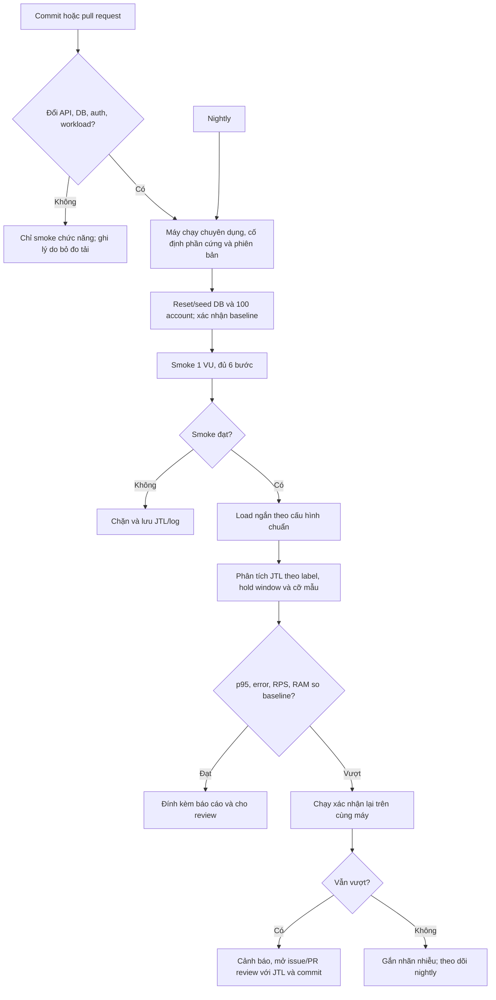

# Đề xuất Continuous Performance Testing (G9.6)

## Quy tắc đề xuất

- Dùng cùng hardware/OS/Java/Node/JMeter, cùng seed DB, thời gian giữ tải và think-time. Không so p95 giữa laptop và runner khác cấu hình. Ghi commit SUT, hash JMX/JTL, PID, CPU/RAM cùng report.
- PR liên quan API, auth, query, database hoặc kịch bản chạy smoke và Load ngắn. Nightly chạy Stress/Spike/soak; lịch cụ thể phụ thuộc thời gian CI và tài nguyên. Khi không có máy riêng, tách cảnh báo hiệu năng khỏi gate cứng.
- Theo dõi p95 **từng endpoint** ở cửa sổ hold và error rate, không chỉ p95 toàn bộ. Ví dụ gate: p95 tăng >20% so với baseline đã khóa, ít nhất 100 mẫu cho label đó, và tái hiện ở 2 lượt liên tiếp. Đây là ngưỡng **đề xuất**, chưa được chứng minh tối ưu cho SUT. Các tiêu chí tuyệt đối từ thiết kế: read p95 ≤500 ms, auth/write ≤2000 ms, lỗi ≤1%; review thủ công trước khi coi là hợp đồng SLA.
- Nếu 6 nhãn thiếu, số iteration không đủ, DB còn category thử, JMeter/Node quá tải CPU hoặc benchmark host chạy tác vụ khác, đánh dấu lượt đo không hợp lệ. Lưu JTL/log gốc để chẩn đoán, không tự cập nhật baseline theo commit có regression.
- Chi phí: full Stress/Spike/soak mất hàng chục phút và chiếm máy; vì vậy PR dùng smoke + Load ngắn, nightly dùng bài dài. False alarm có thể do nhiệt/CPU laptop, cache/GC, thời điểm seed, JIT, cỡ mẫu nhỏ và contention SQLite. Chạy xác nhận lại và theo dõi xu hướng giúp giảm báo động sai nhưng làm chậm phát hiện. Baseline chỉ cập nhật qua review có giải thích, giữ lịch sử cũ.
