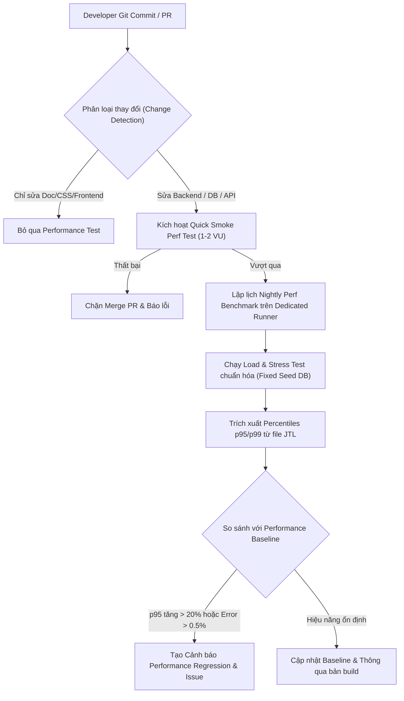

# Báo cáo Kiểm thử Hiệu năng — HW05 Performance Testing

**Học phần:** Kiểm thử Phần mềm / Software Testing  
**Mã bài tập:** HW05 AI — Performance Testing  
**Sinh viên thực hiện:** 23120127  
**SUT (Hệ thống kiểm thử):** EShop Backend REST API (Node.js + Express + SQLite)  
**Upstream Commit:** `85af3ba875c88283615e22cb108f13e2fccaf0e9`  
**Public GitHub Repo:** [https://github.com/duongtronghoa/Hw05](https://github.com/duongtronghoa/Hw05)  
**Demo Video (YouTube Unlisted):** [https://youtu.be/lk0vSGCapsc](https://youtu.be/lk0vSGCapsc)  
**Thời gian thực hiện:** Tháng 11/2026  

---

## 1. Tổng quan & Thiết kế Kịch bản Kiểm thử

### 1.1 Workflow kiểm thử cố định
Để đảm bảo tính nhất quán trên cả ba kịch bản (Load, Stress, Spike) và bao phủ trọn vẹn 3 nhóm API theo yêu cầu đề bài:
* **Auth-heavy:** `POST /api/login` (Xác thực tài khoản Admin, cấp phát JSON Web Token, kiểm soát lockout).
* **Read-heavy:** `GET /api/categories` và `GET /api/products` (Truy vấn danh sách danh mục và sản phẩm, truyền tải payload JSON array).
* **Transactional (Write-heavy):** Chu trình quản lý danh mục toàn diện:
  1. `POST /api/categories` (Tạo danh mục mới với tên sinh động theo iteration).
  2. `PUT /api/categories/${categoryId}` (Cập nhật tên danh mục vừa tạo).
  3. `DELETE /api/categories/${categoryId}` (Xóa danh mục để dọn dẹp dữ liệu).

Workflow đã được sinh viên rà soát và xác nhận không trùng lặp với bất kỳ thành viên nào trong nhóm học tập.

### 1.2 Dữ liệu kiểm thử tham số hóa (Data-Driven Testing)
* Hệ thống sinh 100 tài khoản quản trị viên thử nghiệm `hw05_23120127_001@example.test` đến `hw05_23120127_100@example.test`; script `scripts/prepare_admin_data.py` lưu mật khẩu tổng hợp dạng văn bản trong SQLite và CSV cục bộ. Đây là giới hạn bảo mật của SUT/demo, không phải BCrypt.
* Mỗi Virtual User (VU) truy cập tệp CSV riêng biệt tương ứng theo biến `${__threadNum}`: `../data/admin${__threadNum}.csv`.
* Tên danh mục sử dụng `${category_prefix}_${__UUID()}` để giảm khả năng trùng lặp giữa các VU đồng thời.

### 1.3 Ba cấu hình Test Plan và 3 kiểu Listener khác biệt
Theo đúng quy chuẩn đặt tên `{StudentID}_{ScenarioType}_{YYYYMMDD}.jmx`:
1. `23120127_Load_20261122.jmx`: Sử dụng **Summary Report** listener.
2. `23120127_Stress_20261122.jmx`: Sử dụng **Aggregate Report** listener.
3. `23120127_Spike_20261122.jmx`: Sử dụng **View Results Tree** listener (chỉ bật khi gỡ lỗi, tắt khi chạy CLI để tiết kiệm bộ nhớ).

---

## 2. Môi trường Thực thi & Cấu hình Phần cứng

Việc đo kiểm được tiến hành trên môi trường thực tế với cấu hình phần cứng sau:
* **Tên máy (Hostname):** `TRONGHOA` (Đồng nhất với các bài tập trước).
* **Bộ vi xử lý (CPU):** 12th Gen Intel(R) Core(TM) i7-12700H (14 cores, 20 logical threads).
* **Bộ nhớ RAM:** 16 GB DDR4.
* **Hệ điều hành:** Microsoft Windows 11 Home Single Language (Build 26100).
* **Môi trường chạy:** Node.js v25.0.0, Java OpenJDK 25, Apache JMeter 5.6.3.
* **Bằng chứng phần cứng:** Đính kèm tệp cấu hình chi tiết `evidence/hardware-spec.json` và ảnh chụp `evidence/dxdiag-system.png`.

> [!NOTE]
> **Giới hạn máy đo chung (Co-located Environment):** SUT và JMeter cùng chạy trên một máy tính nên chia sẻ CPU và RAM. Các mức tải báo cáo chỉ là những mức đã thử trên cấu hình này; chưa đo được điểm bão hòa tuyệt đối.

---

## 3. Kết quả Thực thi Task 1 (Load, Stress, Spike, Soak)

Toàn bộ các lượt chạy được thực hiện ở chế độ Non-GUI (CLI) với cờ `-n -t -l -j -e -o` để sinh file log JTL thô và HTML Dashboard nguyên vẹn.

### 3.1 Load Test (Tải danh định)
* **Thông số:** 20 VU, Ramp-up 60 giây, Duy trì 480 giây (8 phút), Think-time 1–3 giây.
* **Kết quả:**
  * Tổng số request: **4.499**, Tỷ lệ lỗi: **0,00%**.
  * Throughput thô: **9,404 request/giây** (~1,55 workflow hoàn chỉnh/giây).
  * Độ trễ toàn cục: p50 = 3 ms, p90 = 6 ms, **p95 = 7 ms**, p99 = 11 ms.
  * Phân rã độ trễ p95 theo API: Login: 2 ms, Categories: 2 ms, Products: 2 ms, Create: 8 ms, Update: 8 ms, Delete: 8 ms.
  * Tài nguyên backend: `node.exe` RSS tối đa đạt 79,44 MiB; CPU hệ thống cao nhất 7,5% trong log monitor.
  * Thư mục bằng chứng: `results/load/load.jtl` (SHA-256: `fa0251a29c8a...`), `results/load/html/index.html`.

### 3.2 Stress Test (Kiểm tra tải cực hạn theo tầng)
* **Thông số:** 4 Thread Group chạy tuần tự: 10 VU → 20 VU → 40 VU → 80 VU (Mỗi tầng ramp 15s, duration 120s).
* **Bảng phân rã chi tiết theo tầng tải:**

| Tầng tải (VU) | Số mẫu (n) | Lỗi | Throughput (req/s) | p50 (ms) | p90 (ms) | p95 (ms) | p99 (ms) | p95 Thao tác ghi cao nhất |
|---|---:|---:|---:|---:|---:|---:|---:|---|
| **10 VU** | 569 | 0 | 4,879 | 3 | 7 | **8** | 13 | 9 ms (`DELETE`) |
| **20 VU** | 1.103 | 0 | 9,310 | 3 | 7 | **8** | 15 | 13 ms (`DELETE`) |
| **40 VU** | 2.201 | 0 | 18,521 | 3 | 8 | **9** | 16 | 11 ms (`POST/PUT`) |
| **80 VU** | 4.491 | 0 | 37,796 | 3 | 17 | **23** | 60 | **32 ms** (`DELETE`), p99 = 152 ms |

* **Nhận định điểm suy giảm hiệu năng (Degradation Point):** Ở 10–40 VU, p95 là 8–9 ms. Khi tải tăng lên 80 VU, p95 toàn cục đạt 23 ms và p99 của DELETE đạt 152 ms. Tranh chấp ghi SQLite là một giả thuyết cần thử nghiệm riêng; JTL không chứng minh nguyên nhân. Không ghi nhận lỗi HTTP trong lượt chạy.
* Tài nguyên: `node.exe` RSS tối đa 92,98 MiB; `java.exe` JMeter RSS tối đa 480,33 MiB.
* Bằng chứng: `results/stress/stress.jtl` (SHA-256: `5f5ebffc713f...`), `results/stress/html/index.html`.

### 3.3 Spike Test (Đo tải đột biến & Khả năng hồi phục)
* **Thông số:** Nền 10 VU (120s, ramp 10s) → Đỉnh đột biến 80 VU (60s, ramp 5s) → Hồi phục 10 VU (120s, ramp 5s).
* **Bảng kết quả theo 3 giai đoạn:**

| Giai đoạn | Số mẫu (n) | Thời lượng (s) | Throughput (req/s) | p50 (ms) | p95 (ms) | p99 (ms) | Trạng thái hồi phục |
|---|---:|---:|---:|---:|---:|---:|---|
| **Phase 1: Base (10 VU)** | 565 | 118,08 | 4,785 | 4 | **9** | 25 | Điểm chuẩn nền |
| **Phase 2: Peak (80 VU)** | 2.262 | 58,14 | 38,907 | 3 | **10** | 17 | Tải tăng gấp 8 lần tức thì |
| **Phase 3: Recovery (10 VU)** | 577 | 117,71 | 4,902 | 3 | **9** | 15 | p95 bằng mức nền |

* **Nhận xét khả năng hồi phục:** Pha sau đỉnh có p95 = 9 ms, bằng pha nền. Khoảng trống 2,155 giây giữa hai pha bao gồm chuyển Thread Group và think-time của JMeter; log không đủ để suy ra backend downtime hoặc thời gian hồi phục chính xác.
* Bằng chứng: `results/spike/spike.jtl` (SHA-256: `3adbf9058ef1...`), `results/spike/html/index.html`.

### 3.4 Soak Test & Ngưỡng Chịu Tải Phần Cứng (Endurance Threshold)
* **Quyết định mức tải:** Dựa trên kết quả Stress test, mức 80 VU chứng minh hệ thống hoạt động ổn định không lỗi. Kịch bản Soak được cấu hình với 80 VU, ramp-up 30s, tổng thời gian 660s (11 phút).
* **Cửa sổ giữ tải ổn định sau ramp (Hold Window):** Kéo dài chính xác 630 giây (10,5 phút) từ `17:21:33` đến `17:32:03`.
* **Thông số định lượng thực nghiệm:**
  * **Sustained Throughput:** **39,711 request/giây** (Tổng 25.018 request trong cửa sổ giữ tải, 0 lỗi).
  * **Độ trễ duy trì (Sustained p95):** Toàn cục đạt **10 ms** (Login: 8 ms, Categories: 8 ms, Products: 7 ms, Create: 13 ms, Update: 12 ms, Delete: 13 ms).
  * **Hành vi bộ nhớ:**
    * Private Bytes của `node.exe` trong cửa sổ giữ tải đạt tối đa **96,45 MiB** và kết thúc ở **95,65 MiB**; không thấy xu hướng tăng đều trong 10,5 phút, nhưng thử nghiệm ngắn này chưa loại trừ rò rỉ dài hạn.
    * Working Set (RSS) giảm từ khoảng 93 MiB xuống 32,38 MiB lúc 17:31:10, trong khi Private Bytes gần như giữ nguyên. Diễn biến này phù hợp với việc Windows thu hồi working set; log không chứng minh nguyên nhân tuyệt đối. **96,45 MiB là giá trị cao nhất quan sát, chưa phải trần bộ nhớ**.
* Bằng chứng: `results/soak/soak.jtl` (SHA-256: `e2f168445e62...`), `results/soak/html/index.html`.

---

## 4. Task 2: Phân tích AI & Săn Lỗi Hiểu Sai (Misinterpretation Hunt)

### 4.1 Bảng đối chiếu lỗi hiểu sai của AI
AI đã thực hiện phân tích dữ liệu thô và xuất bản `analysis/ai-first-pass.md`. Quá trình rà soát độc lập bằng mã nguồn và script phân tích phát hiện 5 lỗi hiểu sai điển hình:

| Khẳng định nguyên văn của AI | Giá trị đúng từ Log thô / Kiểm chứng | Nguyên nhân kỹ thuật AI hiểu sai |
|---|---|---|
| *"Overall test p95 is 18 ms. The backend handled 80 VU without breaking, and latency scaled smoothly with load."* | Tầng 80 VU có p95 toàn cục = **23 ms**; các thao tác ghi có p95 từ **28–32 ms** và p99 DELETE lên tới **152 ms**. | **Ngụy biện gộp mẫu (Aggregation bias):** AI tính p95 gộp chung trên toàn bộ 8.364 mẫu thay vì bóc tách theo từng tầng tải độc lập. |
| *"The throughput achieved is approximately 9.40 transactions per second for the application."* | Thông lượng giao dịch nghiệp vụ (Business Workflows) chỉ đạt **~1,55 workflow/s**. 9,404 chỉ là Gross HTTP Request RPS. | **Đánh đồng Request với Workflow:** Nhầm lẫn giữa số lượng request HTTP đơn lẻ với một chu trình giao dịch gồm 6 bước. |
| *"Node.js v25 garbage collection effectively cleaned up unreferenced heap buffers, operating with a memory ceiling of around 32.4 MiB."* | Private Memory của Node.js quanh **95–96 MiB**; RSS giảm không chứng minh GC hay trần bộ nhớ 32,4 MiB. | **Ngộ nhận chỉ số RAM:** Working Set và Private Bytes đo hai đại lượng khác nhau; việc cả JMeter lẫn Node giảm RSS cùng lúc phù hợp với working-set trim nhưng chưa xác định chắc nguyên nhân. |
| *"A short gap of ~2 seconds between Phase 2 and Phase 3 indicates a brief recovery delay before resuming traffic."* | Khoảng cách 2,155 giây là độ trễ cấu hình tuần tự giữa hai Thread Group độc lập của JMeter và Think-timer. | **Nhầm lẫn cơ chế công cụ với lỗi hệ thống:** Coi thời gian chuyển luồng của JMeter là thời gian backend bị chậm phục hồi. |
| *"Across all four runs, the recorded HTTP response code was uniformly 200 OK with a 0.00% error rate... zero degradation."* | Có từ **6 đến 49 category rác bị bỏ lại** do scheduler dừng giữa chừng. PUT/DELETE với ID không tồn tại vẫn trả 200 OK. | **Thiên kiến mã HTTP (Status Code Bias):** Coi HTTP 200 đồng nghĩa với toàn vẹn nghiệp vụ mà không kiểm tra CSDL backend. |

### 4.2 Đánh giá tính khả thi của các đề xuất tối ưu hóa

1. **Thêm Index trên bảng `categories` (`name`, `id`):**
   * **Phân loại: Hallucinated (Ảo tưởng).**
   * **Lý do:** Bảng `categories` có `id` là Primary Key (SQLite tự động đánh chỉ mục B-Tree). Cột `name` không có mệnh đề tìm kiếm `WHERE name = ?`. Thêm index chỉ làm chậm thao tác INSERT.
2. **Cấu hình Connection Pool cho SQLite (generic-pool size 10–20):**
   * **Phân loại: Hallucinated (Sai kiến trúc).**
   * **Lý do:** SUT đang dùng một `sqlite3.Database`; đề xuất pool 10–20 connection không có căn cứ đo đạc và có thể làm tăng tranh chấp ghi SQLite. Cần benchmark trước khi áp dụng; pool về mặt kỹ thuật vẫn có thể tạo.
3. **Bật chế độ SQLite WAL (Write-Ahead Logging):**
   * **Phân loại: Feasible (Khả thi cao).**
   * **Lý do:** WAL có thể cải thiện đồng thời đọc/ghi, nhưng hiệu quả trên workflow này cần kiểm chứng bằng thử nghiệm A/B cùng dữ liệu và cấu hình.
4. **Thêm B-Tree Index cho `users(email)`:**
   * **Phân loại: Feasible (Khả thi).**
   * **Lý do:** `POST /api/login` thực hiện `SELECT * FROM users WHERE email = ?`. Hiện bảng users chưa có index tường minh cho cột này, gây Full Table Scan khi lượng tài khoản mở rộng.

### 4.3 Các lỗi chức năng & bảo mật phát hiện (chưa đăng GitHub Issues)
Được kiểm chứng qua kịch bản `scripts/probe_edge_cases.py` và lưu tại `analysis/edge-cases.json`:
* **Issue 1 (FR-02):** Logic khóa tài khoản kích hoạt sau **2 lần đăng nhập sai** (thay vì 3 lần theo đặc tả) do biến đếm bị cộng 2 trong code; thời gian khóa là **180 giây** thay vì 30 giây.
* **Issue 2 (FR-12):** Lỗ hổng phân quyền nghiêm trọng khi tài khoản người dùng thông thường (`role: 'user'`) vẫn có thể tạo, sửa, xóa danh mục sản phẩm do route thiếu middleware `requireAdmin`.
* **Quan sát C09:** PUT và DELETE với ID không tồn tại trả `HTTP 200 OK`, nhưng API spec chưa quy định phải trả 404; chưa đủ căn cứ phân loại là bug.

Hai lỗi C07/C08 đã có log tái hiện nhưng **chưa có GitHub Issues hoặc ảnh chụp lỗi**. Xem `SUBMISSION_CHECKLIST.md` trước khi nộp.

---

## 5. Task 3: Mô hình Kiểm thử Hiệu năng Liên tục (Continuous Performance Testing)

Nhằm đáp ứng năng lực Bloom-AI cấp độ **G9.6 (Disrupt)**, dưới đây là đề xuất kiến trúc tích hợp kiểm thử hiệu năng vào quy trình CI/CD:

### Thảo luận về Chi phí và Cảnh báo Giả (Trade-offs)
1. **Chi phí Hạ tầng (Infrastructure Cost):** Chạy kiểm thử tải trên các môi trường CI chia sẻ (như GitHub Actions runner công cộng) có độ nhiễu rất lớn (noisy neighbors) làm sai lệch độ trễ p95. Giải pháp là thiết lập một **Dedicated Self-hosted Runner** cấu hình phần cứng cố định để chạy các đợt Nightly Benchmark, giúp tiết kiệm chi phí CPU mà vẫn đảm bảo độ tin cậy.
2. **Cảnh báo giả (False Alarms / Flakiness):**
   * *Nguyên nhân:* Do các tiến trình nền hệ điều hành (GC, I/O flush, working set trim) gây trồi sụt nhất thời.
   * *Biện pháp giảm thiểu:* Đặt ngưỡng cảnh báo hồi quy tương đối (ví dụ: p95 tăng vượt quá **20%** so với baseline qua ít nhất 2 lần chạy liên tiếp), đồng thời yêu cầu kích thước mẫu tối thiểu ($NN ≥ 500 request) trước khi đưa ra kết luận.

---

## 6. Agent Skill & Kịch bản Tái sử dụng (10 Điểm Tự chọn)

* **Thư mục Skill:** `skill/hw05-api-performance/` bao gồm tài liệu đặc tả [SKILL.md](skill/hw05-api-performance/SKILL.md) và hướng dẫn sử dụng.
* **Tính tổng quát:** Skill được đóng gói cho phép áp dụng quy trình kiểm thử hiệu năng (thiết kế workload, tạo JMX, giám sát tài nguyên, phân tích JTL và phản biện AI) cho bất kỳ REST API nào mà không bị gắn cứng vào nghiệp vụ Category CRUD của MSSV 23120127.
* **Minh chứng chạy thực tế:** Đã thực hiện demo trọn vẹn trên nhóm endpoint **Read-heavy** (`GET /api/categories` và `GET /api/products`), trích xuất thời gian đáp ứng và thống kê số liệu chi tiết lưu trong `demo.md`.

---

## 7. Kết luận & Phụ lục

Báo cáo này phản ánh trung thực toàn bộ quá trình đo kiểm thực nghiệm, phân tích dữ liệu và phản biện đối chiếu AI.

### Phụ lục 1: Nhận xét Phản biện AI (AI Critique)
*(Đính kèm nguyên văn từ tệp `ai-critique.md` / `ai-critique.pdf` — 200–300 từ theo yêu cầu)*

> Trong bài tập kiểm thử hiệu năng này, công cụ AI đã hỗ trợ tạo kịch bản JMeter và trích xuất dữ liệu. Tuy nhiên, phần phân tích có những nhận định sai. AI báo cáo p95 Stress gộp là 18 mili-giây rồi suy ra mức 80 VU vẫn ổn định; riêng tầng 80 VU có p95 toàn cục 23 mili-giây, DELETE p95 32 mili-giây và p99 152 mili-giây. AI cũng đề xuất thêm index cho khóa chính `categories.id` dù SQLite đã đánh chỉ mục cho cột này. Đề xuất pool 10–20 connection SQLite thiếu căn cứ từ mã nguồn hiện tại và cần đo thử trước khi áp dụng. Cuối cùng, AI suy đoán RSS giảm xuống 32,4 MiB là do Node.js dọn rác và coi đó là trần bộ nhớ. Private Bytes thực tế quanh 95–96 MiB; dữ liệu không chứng minh nguyên nhân giảm RSS hay trần bộ nhớ.
>
> Sai sót xảy ra vì AI tổng hợp số liệu toàn bài mà chưa tách từng tầng tải, và đưa ra giải thích kiến trúc khi chưa kiểm tra mã nguồn hoặc phép đo bổ sung. AI còn dựa vào HTTP 200 để kết luận nghiệp vụ thành công, trong khi dữ liệu sau test còn bản ghi danh mục chưa được xóa. PUT/DELETE ID không tồn tại cũng trả 200; đây là hành vi cần đối chiếu đặc tả trước khi gọi là bug.
>
> Nguyên tắc cốt lõi tôi rút ra là AI không bao giờ được xem là nguồn chân lý tuyệt đối trong kiểm thử hiệu năng. Kỹ sư phải luôn kiểm chứng chéo từng khẳng định của AI với log thực thi thô và mã nguồn hệ thống.

* **Phụ lục 2: AI Audit Report:** Nhật ký tương tác P00 → P15 tại [ai_audit.md](ai_audit.md) và [ai_audit.pdf](ai_audit.pdf); xem mục QA để biết các lời khai chưa xác minh độc lập.
* **Phụ lục 3: Git Commit Log:** Được trích xuất đầy đủ từ lịch sử commit thực tế trong file `git-commits.txt`.

