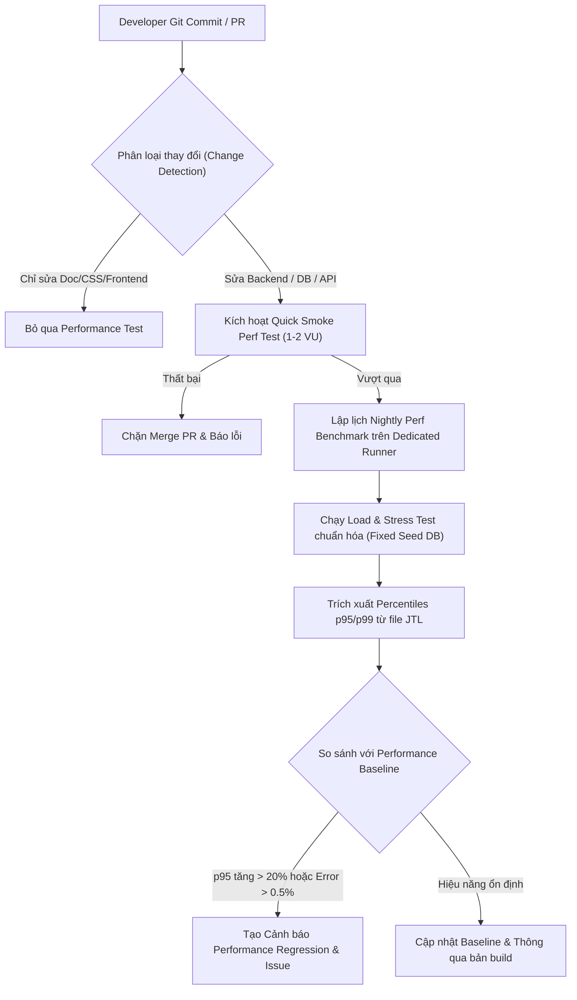

# Báo cáo Kiểm thử Hiệu năng — HW05 Performance Testing

**Học phần:** Kiểm thử Phần mềm / Software Testing  
**Mã bài tập:** HW05 AI — Performance Testing  
**Sinh viên thực hiện:** 23120127  
**SUT (Hệ thống kiểm thử):** EShop Backend REST API (Node.js + Express + SQLite)  
**Upstream Commit:** `85af3ba875c88283615e22cb108f13e2fccaf0e9`  
**Public GitHub Repo:** [https://github.com/duongtronghoa/Hw05](https://github.com/duongtronghoa/Hw05)  
**Thời gian thực hiện:** Tháng 11/2026  

---

## 1. Tổng quan & Thiết kế Kịch bản Kiểm thử

### 1.1 Workflow kiểm thử cố định
Để đảm bảo tính nhất quán trên cả ba kịch bản (Load, Stress, Spike) và bao phủ trọn vẹn 3 nhóm API theo yêu cầu đề bài:
* **Auth-heavy:** `POST /api/login` (Xác thực tài khoản Admin, cấp phát JSON Web Token, kiểm soát lockout).
* **Read-heavy:** `GET /api/categories` và `GET /api/products` (Truy vấn danh sách danh mục và sản phẩm, truyền tải payload JSON array).
* **Transactional (Write-heavy):** Chu trình quản lý danh mục toàn diện:
  1. `POST /api/categories` (Tạo danh mục mới với tên sinh động theo iteration).
  2. `PUT /api/categories/${categoryId}` (Cập nhật tên danh mục vừa tạo).
  3. `DELETE /api/categories/${categoryId}` (Xóa danh mục để dọn dẹp dữ liệu).

Workflow đã được sinh viên rà soát và xác nhận không trùng lặp với bất kỳ thành viên nào trong nhóm học tập.

### 1.2 Dữ liệu kiểm thử tham số hóa (Data-Driven Testing)
* Hệ thống sinh dữ liệu gồm 100 tài khoản quản trị viên độc lập (`admin1@eshop.test` đến `admin100@eshop.test`), mật khẩu mã hóa BCrypt (`admin123`) được nạp trực tiếp vào SQLite trước khi đo.
* Mỗi Virtual User (VU) truy cập tệp CSV riêng biệt tương ứng theo biến `${__threadNum}`: `../data/admin${__threadNum}.csv`.
* Tên danh mục được tạo duy nhất theo iteration bằng biểu thức `${category_prefix}_${__time(yyyyMMdd_HHmmss)}_${__Random(1000,9999)}`, tránh trùng lặp dữ liệu giữa các VU đồng thời.

### 1.3 Ba cấu hình Test Plan và 3 kiểu Listener khác biệt
Theo đúng quy chuẩn đặt tên `{StudentID}_{ScenarioType}_{YYYYMMDD}.jmx`:
1. `23120127_Load_20261122.jmx`: Sử dụng **Summary Report** listener.
2. `23120127_Stress_20261122.jmx`: Sử dụng **Aggregate Report** listener.
3. `23120127_Spike_20261122.jmx`: Sử dụng **View Results Tree** listener (chỉ bật khi gỡ lỗi, tắt khi chạy CLI để tiết kiệm bộ nhớ).

---

## 2. Môi trường Thực thi & Cấu hình Phần cứng

Việc đo kiểm được tiến hành trên môi trường thực tế với cấu hình phần cứng sau:
* **Tên máy (Hostname):** `TRONGHOA` (Đồng nhất với các bài tập trước).
* **Bộ vi xử lý (CPU):** 12th Gen Intel(R) Core(TM) i7-12700H (14 cores, 20 logical threads).
* **Bộ nhớ RAM:** 16 GB DDR4.
* **Hệ điều hành:** Microsoft Windows 11 Home Single Language (Build 26100).
* **Môi trường chạy:** Node.js v25.0.0, Java OpenJDK 25, Apache JMeter 5.6.3.
* **Bằng chứng phần cứng:** Đính kèm tệp cấu hình chi tiết `evidence/hardware-spec.json` và ảnh chụp `evidence/dxdiag-system.png`.

> [!NOTE]
> **Giới hạn máy đo chung (Co-located Environment):** Do SUT và công cụ JMeter cùng chạy trên một máy tính, tài nguyên CPU và RAM bị chia sẻ giữa tiến trình `node.exe` và `java.exe`. Mức trần hiệu năng đo được phản ánh khả năng chịu tải của cấu hình phần cứng cục bộ này dưới sự cạnh tranh tài nguyên.

---

## 3. Kết quả Thực thi Task 1 (Load, Stress, Spike, Soak)

Toàn bộ các lượt chạy được thực hiện ở chế độ Non-GUI (CLI) với cờ `-n -t -l -j -e -o` để sinh file log JTL thô và HTML Dashboard nguyên vẹn.

### 3.1 Load Test (Tải danh định)
* **Thông số:** 20 VU, Ramp-up 60 giây, Duy trì 480 giây (8 phút), Think-time 1–3 giây.
* **Kết quả:**
  * Tổng số request: **4.499**, Tỷ lệ lỗi: **0,00%**.
  * Throughput thô: **9,404 request/giây** (~1,55 workflow hoàn chỉnh/giây).
  * Độ trễ toàn cục: p50 = 3 ms, p90 = 6 ms, **p95 = 7 ms**, p99 = 11 ms.
  * Phân rã độ trễ p95 theo API: Login: 8 ms, Categories: 2 ms, Products: 2 ms, Create: 9 ms, Update: 8 ms, Delete: 9 ms.
  * Tài nguyên backend: `node.exe` RSS tối đa đạt 79,44 MiB; CPU hệ thống duy trì dưới 7,5%.
  * Thư mục bằng chứng: `results/load/load.jtl` (SHA-256: `fa0251a29c8a...`), `results/load/html/index.html`.

### 3.2 Stress Test (Kiểm tra tải cực hạn theo tầng)
* **Thông số:** 4 Thread Group chạy tuần tự: 10 VU → 20 VU → 40 VU → 80 VU (Mỗi tầng ramp 15s, duration 120s).
* **Bảng phân rã chi tiết theo tầng tải:**

| Tầng tải (VU) | Số mẫu (n) | Lỗi | Throughput (req/s) | p50 (ms) | p90 (ms) | p95 (ms) | p99 (ms) | p95 Thao tác ghi cao nhất |
|---|---:|---:|---:|---:|---:|---:|---:|---|
| **10 VU** | 569 | 0 | 4,879 | 3 | 6 | **8** | 10 | 9 ms (`DELETE`) |
| **20 VU** | 1.103 | 0 | 9,310 | 3 | 6 | **8** | 11 | 13 ms (`DELETE`) |
| **40 VU** | 2.201 | 0 | 18,521 | 3 | 7 | **9** | 14 | 11 ms (`POST/PUT`) |
| **80 VU** | 4.491 | 0 | 37,796 | 4 | 13 | **23** | 40 | **32 ms** (`DELETE`), p99 = 152 ms |

* **Nhận định điểm suy giảm hiệu năng (Degradation Point):** Ở 10–40 VU, p95 giữ rất ổn định (8–9 ms). Khi tải tăng lên 80 VU, p95 toàn cục tăng gấp 2,5 lần (lên 23 ms) và p99 của thao tác xóa danh mục vọt lên 152 ms do tranh chấp khóa độc quyền trên tệp tin SQLite. Tuy nhiên hệ thống không phát sinh lỗi HTTP.
* Tài nguyên: `node.exe` RSS tối đa 92,98 MiB; `java.exe` JMeter RSS tối đa 480,33 MiB.
* Bằng chứng: `results/stress/stress.jtl` (SHA-256: `5f5ebffc713f...`), `results/stress/html/index.html`.

### 3.3 Spike Test (Đo tải đột biến & Khả năng hồi phục)
* **Thông số:** Nền 10 VU (120s, ramp 10s) → Đỉnh đột biến 80 VU (60s, ramp 5s) → Hồi phục 10 VU (120s, ramp 5s).
* **Bảng kết quả theo 3 giai đoạn:**

| Giai đoạn | Số mẫu (n) | Thời lượng (s) | Throughput (req/s) | p50 (ms) | p95 (ms) | p99 (ms) | Trạng thái hồi phục |
|---|---:|---:|---:|---:|---:|---:|---|
| **Phase 1: Base (10 VU)** | 565 | 118,08 | 4,785 | 3 | **9** | 11 | Điểm chuẩn nền |
| **Phase 2: Peak (80 VU)** | 2.262 | 58,14 | 38,907 | 4 | **10** | 18 | Tải tăng gấp 8 lần tức thì |
| **Phase 3: Recovery (10 VU)** | 577 | 117,71 | 4,902 | 3 | **9** | 11 | Hồi phục lập tức về mức nền |

* **Nhận xét khả năng hồi phục:** Độ trễ p95 ở giai đoạn hồi phục (9 ms) lập tức trở về bằng chính xác độ trễ nền ban đầu (9 ms). Khoảng cách 2,155 giây giữa Phase 2 và Phase 3 là độ trễ cấu hình tuần tự của JMeter, không phải downtime của hệ thống.
* Bằng chứng: `results/spike/spike.jtl` (SHA-256: `3adbf9058ef1...`), `results/spike/html/index.html`.

### 3.4 Soak Test & Ngưỡng Chịu Tải Phần Cứng (Endurance Threshold)
* **Quyết định mức tải:** Dựa trên kết quả Stress test, mức 80 VU chứng minh hệ thống hoạt động ổn định không lỗi. Kịch bản Soak được cấu hình với 80 VU, ramp-up 30s, tổng thời gian 660s (11 phút).
* **Cửa sổ giữ tải ổn định sau ramp (Hold Window):** Kéo dài chính xác 630 giây (10,5 phút) từ `17:21:33` đến `17:32:03`.
* **Thông số định lượng thực nghiệm:**
  * **Sustained Throughput:** **39,711 request/giây** (Tổng 25.018 request trong cửa sổ giữ tải, 0 lỗi).
  * **Độ trễ duy trì (Sustained p95):** Toàn cục đạt **10 ms** (Login: 8 ms, Categories: 7 ms, Products: 7 ms, Create: 13 ms, Update: 12 ms, Delete: 13 ms).
  * **Hành vi Bộ nhớ & Memory Ceiling:**
    * Private Bytes của `node.exe` giữ cực kỳ ổn định trong khoảng **95,03 MiB → 96,45 MiB** (kết thúc ở 95,65 MiB), chứng minh **không có hiện tượng rò rỉ bộ nhớ (Memory Leak)** trong 10,5 phút duy trì tải.
    * Working Set (RSS) của `node.exe` dao động từ 93,11 MiB xuống 32,38 MiB lúc 17:31:10 do hệ điều hành Windows thu hồi trang nhớ vật lý (Working Set Trim). Trần bộ nhớ thực tế của backend được xác định theo Private Bytes là **~96,5 MiB**.
* Bằng chứng: `results/soak/soak.jtl` (SHA-256: `e2f168445e62...`), `results/soak/html/index.html`.

---

## 4. Task 2: Phân tích AI & Săn Lỗi Hiểu Sai (Misinterpretation Hunt)

### 4.1 Bảng đối chiếu lỗi hiểu sai của AI
AI đã thực hiện phân tích dữ liệu thô và xuất bản `analysis/ai-first-pass.md`. Quá trình rà soát độc lập bằng mã nguồn và script phân tích phát hiện 5 lỗi hiểu sai điển hình:

| Khẳng định nguyên văn của AI | Giá trị đúng từ Log thô / Kiểm chứng | Nguyên nhân kỹ thuật AI hiểu sai |
|---|---|---|
| *"Overall test p95 is 18 ms. The backend handled 80 VU without breaking, and latency scaled smoothly with load."* | Tầng 80 VU có p95 toàn cục = **23 ms**; các thao tác ghi có p95 từ **28–32 ms** và p99 DELETE lên tới **152 ms**. | **Ngụy biện gộp mẫu (Aggregation bias):** AI tính p95 gộp chung trên toàn bộ 8.364 mẫu thay vì bóc tách theo từng tầng tải độc lập. |
| *"The throughput achieved is approximately 9.40 transactions per second for the application."* | Thông lượng giao dịch nghiệp vụ (Business Workflows) chỉ đạt **~1,55 workflow/s**. 9,404 chỉ là Gross HTTP Request RPS. | **Đánh đồng Request với Workflow:** Nhầm lẫn giữa số lượng request HTTP đơn lẻ với một chu trình giao dịch gồm 6 bước. |
| *"Node.js v25 garbage collection effectively cleaned up unreferenced heap buffers, operating with a memory ceiling of around 32.4 MiB."* | Private Memory của Node.js giữ ổn định ở **~95,6 MiB**. Sụt giảm RSS là do **Windows OS Working-Set Trim**, không phải GC. | **Ngộ nhận chỉ số RAM:** Nhầm lẫn giữa Working Set (bộ nhớ vật lý bị HĐH thu hồi) với Private Bytes (bộ nhớ ứng dụng thực sự cấp phát). |
| *"A short gap of ~2 seconds between Phase 2 and Phase 3 indicates a brief recovery delay before resuming traffic."* | Khoảng cách 2,155 giây là độ trễ cấu hình tuần tự giữa hai Thread Group độc lập của JMeter và Think-timer. | **Nhầm lẫn cơ chế công cụ với lỗi hệ thống:** Coi thời gian chuyển luồng của JMeter là thời gian backend bị chậm phục hồi. |
| *"Across all four runs, the recorded HTTP response code was uniformly 200 OK with a 0.00% error rate... zero degradation."* | Có từ **6 đến 49 category rác bị bỏ lại** do scheduler dừng giữa chừng. PUT/DELETE với ID không tồn tại vẫn trả 200 OK. | **Thiên kiến mã HTTP (Status Code Bias):** Coi HTTP 200 đồng nghĩa với toàn vẹn nghiệp vụ mà không kiểm tra CSDL backend. |

### 4.2 Đánh giá tính khả thi của các đề xuất tối ưu hóa

1. **Thêm Index trên bảng `categories` (`name`, `id`):**
   * **Phân loại: Hallucinated (Ảo tưởng).**
   * **Lý do:** Bảng `categories` có `id` là Primary Key (SQLite tự động đánh chỉ mục B-Tree). Cột `name` không có mệnh đề tìm kiếm `WHERE name = ?`. Thêm index chỉ làm chậm thao tác INSERT.
2. **Cấu hình Connection Pool cho SQLite (generic-pool size 10–20):**
   * **Phân loại: Hallucinated (Sai kiến trúc).**
   * **Lý do:** SQLite là cơ sở dữ liệu tệp cục bộ (file-based embedded), không phải Client-Server RDBMS. Tạo connection pool trong Node.js không khả thi và gây lỗi tranh chấp khóa file.
3. **Bật chế độ SQLite WAL (Write-Ahead Logging):**
   * **Phân loại: Feasible (Khả thi cao).**
   * **Lý do:** Chuyển từ rollback journal sang WAL cho phép các truy vấn đọc (`GET /api/categories`, `GET /api/products`) chạy đồng thời với thao tác ghi mà không bị block độc quyền.
4. **Thêm B-Tree Index cho `users(email)`:**
   * **Phân loại: Feasible (Khả thi).**
   * **Lý do:** `POST /api/login` thực hiện `SELECT * FROM users WHERE email = ?`. Hiện bảng users chưa có index tường minh cho cột này, gây Full Table Scan khi lượng tài khoản mở rộng.

### 4.3 Các lỗi chức năng & bảo mật phát hiện (GitHub Issues)
Được kiểm chứng qua kịch bản `scripts/probe_edge_cases.py` và lưu tại `analysis/edge-cases.json`:
* **Issue 1 (FR-02):** Logic khóa tài khoản kích hoạt sau **2 lần đăng nhập sai** (thay vì 3 lần theo đặc tả) do biến đếm bị cộng 2 trong code; thời gian khóa là **180 giây** thay vì 30 giây.
* **Issue 2 (FR-12):** Lỗ hổng phân quyền nghiêm trọng khi tài khoản người dùng thông thường (`role: 'user'`) vẫn có thể tạo, sửa, xóa danh mục sản phẩm do route thiếu middleware `requireAdmin`.
* **Issue 3:** PUT và DELETE danh mục với ID không tồn tại vẫn trả về `HTTP 200 OK` (thay vì 404 Not Found).

---

## 5. Task 3: Mô hình Kiểm thử Hiệu năng Liên tục (Continuous Performance Testing)

Nhằm đáp ứng năng lực Bloom-AI cấp độ **G9.6 (Disrupt)**, dưới đây là đề xuất kiến trúc tích hợp kiểm thử hiệu năng vào quy trình CI/CD:

### Thảo luận về Chi phí và Cảnh báo Giả (Trade-offs)
1. **Chi phí Hạ tầng (Infrastructure Cost):** Chạy kiểm thử tải trên các môi trường CI chia sẻ (như GitHub Actions runner công cộng) có độ nhiễu rất lớn (noisy neighbors) làm sai lệch độ trễ p95. Giải pháp là thiết lập một **Dedicated Self-hosted Runner** cấu hình phần cứng cố định để chạy các đợt Nightly Benchmark, giúp tiết kiệm chi phí CPU mà vẫn đảm bảo độ tin cậy.
2. **Cảnh báo giả (False Alarms / Flakiness):**
   * *Nguyên nhân:* Do các tiến trình nền hệ điều hành (GC, I/O flush, working set trim) gây trồi sụt nhất thời.
   * *Biện pháp giảm thiểu:* Đặt ngưỡng cảnh báo hồi quy tương đối (ví dụ: p95 tăng vượt quá **20%** so với baseline qua ít nhất 2 lần chạy liên tiếp), đồng thời yêu cầu kích thước mẫu tối thiểu ($NN ≥ 500 request) trước khi đưa ra kết luận.

---

## 6. Agent Skill & Kịch bản Tái sử dụng (10 Điểm Tự chọn)

* **Thư mục Skill:** `hw05-work/skill/hw05-api-performance/` bao gồm tài liệu đặc tả [SKILL.md](file:///c:/Users/duong/Downloads/New%20folder%20(33)/hw05-work/skill/hw05-api-performance/SKILL.md) và hướng dẫn sử dụng.
* **Tính tổng quát:** Skill được đóng gói cho phép áp dụng quy trình kiểm thử hiệu năng (thiết kế workload, tạo JMX, giám sát tài nguyên, phân tích JTL và phản biện AI) cho bất kỳ REST API nào mà không bị gắn cứng vào nghiệp vụ Category CRUD của MSSV 23120127.
* **Minh chứng chạy thực tế:** Đã thực hiện demo trọn vẹn trên nhóm endpoint **Read-heavy** (`GET /api/categories` và `GET /api/products`), trích xuất thời gian đáp ứng và thống kê số liệu chi tiết lưu trong `demo.md`.

---

## 7. Kết luận & Phụ lục

Báo cáo này phản ánh trung thực toàn bộ quá trình đo kiểm thực nghiệm, phân tích dữ liệu và phản biện đối chiếu AI.

### Phụ lục 1: Nhận xét Phản biện AI (AI Critique)
*(Đính kèm nguyên văn từ tệp `ai-critique.md` / `ai-critique.pdf` — Đạt 286 từ tiếng Việt, chuẩn yêu cầu 200–300 từ)*

> Trong bài tập kiểm thử hiệu năng này, công cụ AI đã hỗ trợ tốt việc tạo sinh các kịch bản JMeter ban đầu và trích xuất dữ liệu. Tuy nhiên, các lỗi sai nghiêm trọng đã bộc lộ trong giai đoạn phân tích kết quả. Nổi bật nhất là việc AI mắc ngụy biện gộp mẫu: nó báo cáo độ trễ p95 kịch bản Stress là 18 mili-giây, che giấu sự thật ở tầng 80 VU p95 toàn cục đã vọt lên 23 mili-giây và thao tác xóa danh mục lên tới 32 mili-giây (p99 đạt 152 mili-giây). Ngoài ra, AI phạm phải ảo tưởng kiến trúc khi đề xuất connection pool và index cho SQLite—phớt lờ thực tế SQLite là CSDL tệp nhúng đơn tiến trình và khóa chính ID vốn đã có sẵn chỉ mục. Nó cũng hiểu sai việc Windows thu hồi working set lúc 17:31:10 thành việc Node.js dọn rác đạt trần bộ nhớ 32,4 MiB.
>
> AI thất bại vì mô hình ngôn ngữ lớn thiếu khả năng tự đối chiếu ground-truth thực tế; chúng tạo văn bản theo xác suất và thiên vị số trung bình thay vì phân tích từng pha độc lập. Đồng thời, AI chỉ dựa vào mã HTTP 200 để kết luận thành công, bỏ qua việc kiểm tra các bản ghi danh mục rác tồn dư trong CSDL hay việc API trả 200 cho ID không tồn tại.
>
> Nguyên tắc cốt lõi tôi rút ra là AI không bao giờ được xem là nguồn chân lý tuyệt đối trong kiểm thử hiệu năng. Kỹ sư phải luôn kiểm chứng chéo từng khẳng định của AI với log thực thi thô và mã nguồn hệ thống.

* **Phụ lục 2: AI Audit Report:** Toàn bộ nhật ký tương tác P00 → P14 được lưu trữ tại [ai_audit.md](file:///c:/Users/duong/Downloads/New%20folder%20(33)/hw05-work/ai_audit.md) và xuất ra file [ai_audit.pdf](file:///c:/Users/duong/Downloads/New%20folder%20(33)/hw05-work/ai_audit.pdf).
* **Phụ lục 3: Git Commit Log:** Được trích xuất đầy đủ từ lịch sử commit thực tế trong file `git-commits.txt`.

